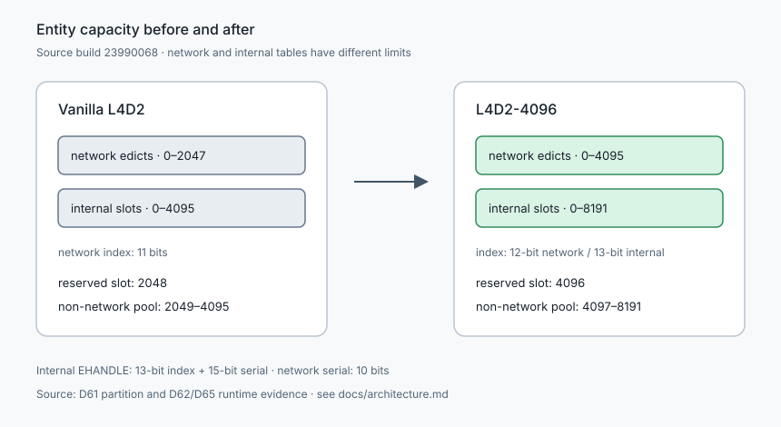
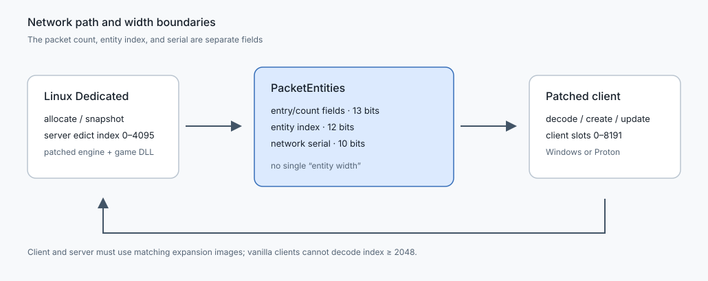
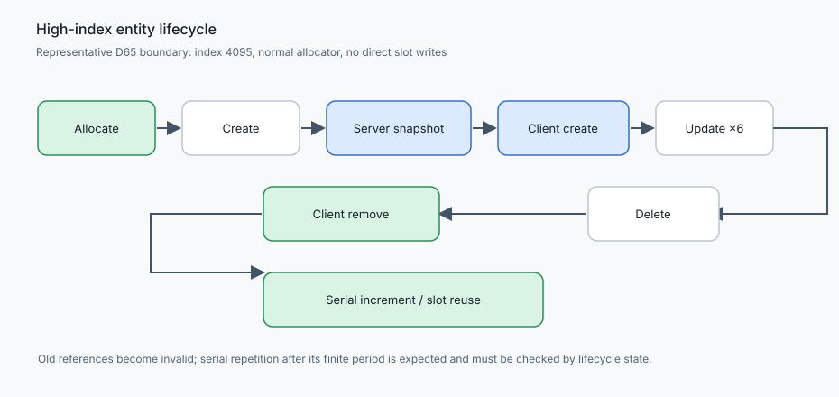
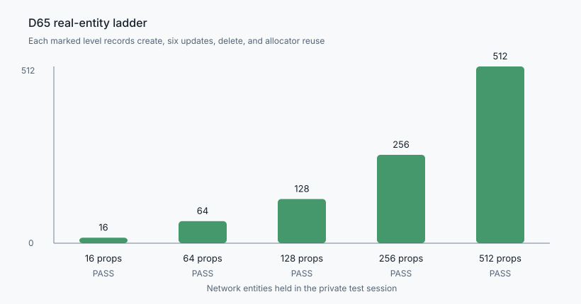
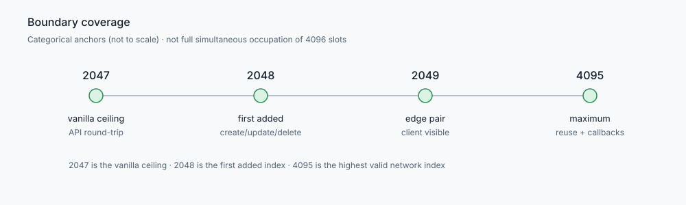

# L4D2 Entity Limit Expansion — 2048 to 4096

L4D2-4096 is an unofficial, build-pinned expansion of the **Left 4 Dead 2** network entity limit. It raises the network range from `0..2047` to `0..4095` and the internal entity table from 4096 to 8192 slots while keeping the original Source entity semantics.

This is an experimental release candidate for private testing environments. It is not a Valve product, does not bypass Steam ownership or authentication, and does not include Valve binaries. High-index network operation requires compatible patched client and dedicated-server images; basic connectivity below the original limit is a separate, narrower claim.

## Current release status

**PARTIALLY_READY.** The tested setup is a Linux dedicated server with a Windows client through Proton. D65/D66 verified entity creation, synchronization and reuse up to index `4095`, plus map transitions and bounded load tests. An in-game filler-assisted test also observed a common infected at index `2158`.

- **Linux native client:** Server-connected gameplay has been tested. High-index support has not been verified; occasional loading/rendering issues remain uninvestigated.
- **Windows single-player:** 4096-edict listen-server mode is not yet supported. The current Windows release does not include a patched `server.dll`.
- **Pending:** Native Windows acceptance, two-client testing, long-duration stability and full 4096-slot occupancy. Details: [compatibility](docs/compatibility.md) and [limitations](docs/limitations.md).

## What is supported

| Component | Status | Evidence boundary |
| --- | --- | --- |
| Linux dedicated server | Experimental | Real D65 Proton/client sessions; patched `engine_srv.so` and `server_srv.so` |
| Windows client image | Experimental; native runtime unverified | Real patched module observations at 2048, 2049 and 4095 through Proton |
| Proton Windows client | Experimental | End-to-end connection, updates, deletion, reuse and map transition |
| Windows native dedicated server | Not tested | Do not list as supported |
| Linux native client | Gameplay tested | Connected and played; high-index support unverified, occasional loading/rendering issues |
| Windows single-player / listen server | Not supported yet | Windows `server.dll` is not included in this release |
| SourceMod core / SDKTools / SDKHooks | Limited compatible build | Only the API and callbacks in the D65 probe are covered |

## Install the release modules

Use a Python 3 interpreter and a legally installed build `23990068`. The
installer verifies the source hashes, backs up only the manifest-listed DLLs
next to the originals, and replaces those modules in the existing Steam game
directory. It does not copy the game tree or addons.

Check a Windows or Proton client source:

```bash
python3 tools/release/install.py check \
  --manifest release/manifests/windows-client.json \
  --game "/path/to/Left 4 Dead 2"
```

Preview the source without changing files:

```bash
python3 tools/release/install.py install \
  --manifest release/manifests/windows-client.json \
  --game "/path/to/Left 4 Dead 2" \
  --dry-run

python3 tools/release/install.py install \
  --manifest release/manifests/windows-client.json \
  --game "/path/to/Left 4 Dead 2"
```

For a Linux dedicated server, use `release/manifests/linux-server.json` with
the server root. The installer writes `*.l4d2-4096.bak` beside each patched
module and stores `l4d2-4096-install.json` in the game directory. Restore the
original modules with:

```bash
python3 tools/release/install.py restore \
  --receipt "/path/to/Left 4 Dead 2/l4d2-4096-install.json"
```

The game must be closed while modules are replaced. Steam may overwrite a
patched module during a game update; run `check` and `install` again after an
update. See [installation](docs/installation.md) for recovery details.

## Verified behavior











| Boundary or load | Result |
| --- | --- |
| `2047` | Vanilla ceiling and API control |
| `2048` | First added index; client create/update/delete |
| `2049` | High-index client observation and reuse |
| `16/64/128/256/512` | Create, six updates, delete, reuse in real sessions |
| `4095` | Normal allocator boundary; create, six updates, delete, reuse, SDKHooks callbacks |
| Special infected | Hunter, Spitter, Smoker, Boomer, Charger and Jockey under 512 live high-index props |
| Map transition | `c1m1_hotel → c1m2_streets`, then high-index recreation and synchronization |
| Wire serial wrap | Index 2229, 1024 ordinary reuse cycles, client/server `1023 → 0 → 1` and return to initial wire serial |
| Gameplay-assisted crossing of 2048 | `c6m1_riverbank`: Logger `All: 2374`, `Networked: 2159`; VScript `max=2158`, `maxclass=infected`, `over2047=105` after persistent hidden prop fill. Server-side only; not natural-only load or a fresh client-sync trace |

[2026-10-31 gameplay evidence](artifacts/entity-index-20261031/README.md): [Logger](artifacts/entity-index-20261031/entity_limit_2026-10-31_00-20-00.log), [index scan](artifacts/entity-index-20261031/runtime-index-scan.txt) and [test scripts](artifacts/entity-index-20261031/entity_index_fill.nut).

The machine-readable D65 record is [reports/n27d65/validation.json](reports/n27d65/validation.json), with the narrative in [reports/n27d65/findings.md](reports/n27d65/findings.md). D66’s release decision and test boundaries are in [reports/n27d66/release-readiness.md](reports/n27d66/release-readiness.md); the final gate is [reports/n27d66/validation.json](reports/n27d66/validation.json), with [wire serial](reports/n27d66/network-serial.json), [bounded soak](reports/n27d66/bounded-soak.json), and [SourceMod smoke](reports/n27d66/sourcemod-smoke.json) records.

## Architecture and verification

- [Technical report](docs/technical-report.md)
- [Patch map](docs/patch-map.md)
- [Evidence and reproduction](docs/evidence-and-reproduction.md)
- [Architecture and bit-widths](docs/architecture.md)
- [Installation and recovery](docs/installation.md)
- [Compatibility matrix](docs/compatibility.md)
- [Verification model](docs/verification.md)
- [Limitations](docs/limitations.md)
- [Troubleshooting](docs/troubleshooting.md)
- [Development and reproducible builds](docs/development.md)
- [Research index](docs/research-index.md)
- [Demo storyboard and capture script](docs/demo/storyboard.md)

Run the release-candidate gate against the local D65 evidence:

```bash
python3 tools/release/check_rc.py \
  --manifest release/manifests/windows-client.json \
  --manifest release/manifests/linux-server.json \
  --evidence-root /path/to/runs/d65
```

The gate reports static identity, manifest, evidence-integrity, and end-to-end scope separately. A `PASS` for a checked layer never turns an untested layer into a pass.

## Important limits

- All addresses and byte assertions are bound to build `23990068`; a Steam update invalidates them.
- Vanilla clients cannot decode network indices at or above `2048`.
- Wire serial repeats after 1024 reuse cycles as expected. The internal 15-bit wrap remains `NOT_TESTED`.
- Full 4096-slot occupancy, long-duration stability and native Linux high-index client support remain unverified.
- VAC safety, public matchmaking, and public release distribution are unverified.
- Third-party SourceMod native extensions are not covered by the limited compatibility build.
- The installer touches only the manifest-listed modules; addons and the rest of the Steam tree are left in place.

## Provenance

The repository contains research data, patch manifests, scripts and documentation. It does not contain Valve’s original or modified game binaries. See [research-index](docs/research-index.md) for the historical evidence chain and the reports that were superseded by later runtime observations.
